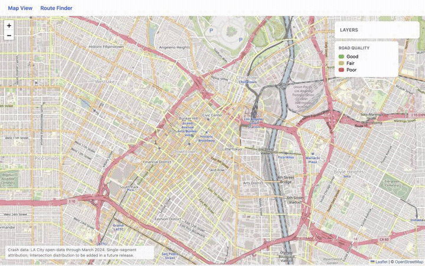
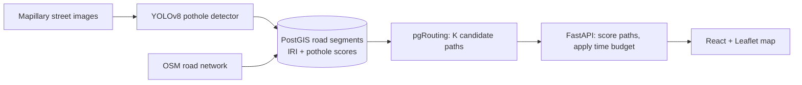

# Road Quality Router

**Pothole-aware driving routes for Los Angeles.** Pick a start and a destination and compare the fastest route with one that avoids rough roads and potholes detected by YOLOv8 in real street-level imagery, within a time budget you set.

**Live demo:** [road-quality-frontend.fly.dev](https://road-quality-frontend.fly.dev/) (no sign-in; LA only)



## What's interesting

- **Computer vision on real data.** Street-level photos from Mapillary across 12 LA zones run through a YOLOv8 pothole segmentation model. Detections become per-segment pothole scores that feed routing end to end.
- **An honest negative result.** I hand-labelled 1,322 LA images and fine-tuned the detector twice; neither beat the public baseline on a held-out split, so I shipped the baseline and [documented why](docs/DETECTOR_EVAL.md).
- **Fast routing over a big graph.** Cross-LA routes over ~209k road segments return in ~2.5s (short downtown trips ~0.4s). The fix: pre-filter an origin-destination corridor through a GiST index, then run `pgr_dijkstra` K times with edge-weight perturbation instead of Yen's k-shortest-paths.
- **Production-shaped.** Three Fly.io apps (Postgres, API, frontend) deploy from `main` via GitHub Actions, with 200+ backend tests.

## How it works



Each road segment carries a roughness score (IRI, normalized 0 to 1) and pothole scores (moderate and severe, from detection count and confidence). A route's cost is:

```
penalty = w_IRI * IRI_norm + w_pothole * pothole_score + w_crash * crash_norm   (0 to 1)
cost    = travel_time * (1 + 5 * penalty)
```

So a minute on a pothole-heavy street counts as almost three minutes. The API takes the fastest paths plus the path that minimizes this cost, drops any that exceed the fastest route's time by more than your budget, and returns the lowest-cost one as the "best" route. Details: [docs/API.md](docs/API.md).

## Tech Stack

| Layer | Technology |
|-------|-----------|
| Frontend | React 18, TypeScript, Vite, Tailwind CSS, react-leaflet |
| Backend | FastAPI, Python 3.12, psycopg2 |
| Database | PostgreSQL 16 + PostGIS 3.4 + pgRouting 3.6 |
| ML | YOLOv8 (`keremberke/yolov8s-pothole-segmentation`), Hugging Face Hub, revision-pinned weights |
| Data | Mapillary imagery, OSMnx road network, LA City open data |
| Deploy | Docker Compose (local), Fly.io (production), GitHub Actions |

## Quick Start

### Prerequisites

- Docker & Docker Compose (Docker Desktop installed, needs restart to activate)
- Python 3.12+ (for seed script)
- Node.js 20+ (for frontend dev)

### 1. Start the database

```bash
docker compose up db -d
```

Wait for healthcheck to pass (~10 seconds).

### 2. Seed data

```bash
pip install -r scripts/requirements.txt
python scripts/seed_data.py
```

This downloads the LA road network (~20 km radius) via OSMnx and generates synthetic IRI + pothole data. Takes a few minutes on first run.

### 3. Start backend

```bash
cd backend
pip install -r requirements.txt
uvicorn app.main:app --reload --port 8000
```

### 4. Start frontend

```bash
cd frontend
npm install
npm run dev
```

Visit http://localhost:3000

### Docker Compose (all services)

```bash
docker compose up --build
```

## Configuration

Environment variables are documented in [`.env.example`](.env.example). A few that operators may want to tune:

- **`ROUTE_FILTER_BUFFER_DEG`** (default `0.03` ≈ 3.3 km) — Spatial buffer around the route bbox used by the `segment_scores` temp-table filter in [`backend/app/routes/routing.py:22`](backend/app/routes/routing.py). Wider covers more candidate detours; narrower keeps the temp-table small to honor the Phase 8 5s perf budget. Tuning rationale: see [`.planning/milestones/v0.3.0-phases/08-routing-performance/08-PERF-NUMBERS.md`](.planning/milestones/v0.3.0-phases/08-routing-performance/08-PERF-NUMBERS.md).
- **`ROUTE_FILTER_WIDEN_FACTOR`** (default `2.0` → 6.6 km) — Multiplier for the wide-fallback buffer when the initial filter returns zero candidates. Part of the 3-attempt fallback chain: filter → wide → full ([`backend/app/routes/routing.py:23`](backend/app/routes/routing.py)). Tune up for sparse-corner routes; down for tight perf. Same tuning reference.
- **`LACITY_APP_TOKEN`** (Phase 9, optional) — Socrata API token for `scripts/ingest_crashes.py`. Anonymous fetch works at a lower shared-IP rate limit; a token is recommended for the Phase 12 quarterly operator-driven re-pull.
- **`LACITY_SNAP_M`** (Phase 9, default `50.0` meters) — Snap-match radius cap for crash → road-segment attribution.

For the canonical v0.4.0 API contract (silent-ignore of legacy `weight_iri` / `weight_potholes`, `Deprecation` response header, locked weights `W_IRI=0.40 / W_POT=0.35 / W_CRASH=0.25`), see [`docs/API.md`](docs/API.md).

## API Endpoints

### GET /health

LB-probe-friendly DB-reachability check.

- Success: `200` + `{"status": "ok", "db": "reachable"}`
- DB unreachable: `503` + `{"detail": {"status": "unhealthy", "db": "unreachable"}}`

Fly's HTTP health check treats non-2xx as unhealthy and depools the machine
(does not restart it), so the 503 path is the right code for a transient DB
hiccup. The PRD M0 contract `{"status": "ok"}` is preserved as an additive
superset (the `db` field is new in Phase 5).

### POST /route
Find the best quality-aware route.

**Request body:**
```json
{
  "origin": {"lat": 34.05, "lon": -118.24},
  "destination": {"lat": 34.06, "lon": -118.25},
  "include_iri": true,
  "include_potholes": true,
  "weight_iri": 60,
  "weight_potholes": 40,
  "max_extra_minutes": 5
}
```

**Response:** `fastest_route`, `best_route` (with GeoJSON + metrics), optional `warning`, `per_segment_metrics`

### GET /segments?bbox=min_lon,min_lat,max_lon,max_lat
Returns GeoJSON FeatureCollection of road segments within the bounding box, with properties: `id`, `iri_norm`, `moderate_score`, `severe_score`, `pothole_score_total`.

## Detector Accuracy

The YOLOv8 pothole detector is evaluated on a hand-labelled LA eval set
sourced from Mapillary across 12 LA zones (sequence-grouped 70/20/10
train/val/test split, single-class "pothole" with severity derived from
detection confidence). Metrics reported: precision, recall, mAP@0.5,
each with image-level bootstrap 95% CIs at IoU=0.5 (1000 resamples,
seed=42). Full methodology and measurements:
[`docs/DETECTOR_EVAL.md`](docs/DETECTOR_EVAL.md).

Reproduce from a clean checkout — see
[`docs/FINETUNE.md`](docs/FINETUNE.md) for laptop / Colab / EC2 training
recipes:

```bash
# verify dataset integrity (SHA256-pinned manifest)
python scripts/fetch_eval_data.py

# run eval on the held-out test split
python scripts/eval_detector.py --data data/eval_la/data.yaml --split test
```

Configuration: set `YOLO_MODEL_PATH` in `.env` to either a HuggingFace
repo id (`<user>/<repo>@<revision>`) or a local `.pt` file path. Pickle-ACE
drift protection: revision SHAs are pinned at the `_DEFAULT_HF_REPO`
constant in `data_pipeline/detector_factory.py` (see comment block for
the bump procedure).

## Real-Data Ingest

The `scripts/ingest_mapillary.py` CLI pulls Mapillary imagery for a target
list of road segments, runs the YOLOv8 detector, and writes detections back
into `segment_defects` with full provenance (`source = 'mapillary'`,
`source_mapillary_id = <image_id>`). Re-runs are idempotent.

Three target modes — explicit ids, ids-file, or `--where` SQL predicate.
After each ingest, the CLI auto-runs `scripts/compute_scores.py` so
`/segments` and `/route` reflect the new detections.

See [`docs/MAPILLARY_INGEST.md`](docs/MAPILLARY_INGEST.md) for the operator
runbook: prerequisites, all flags, the SC #4 ranking-comparison demo
workflow, the Phase 6 public-demo cutover sequence, and the trust model
for `--where`.

Quick start (after `MAPILLARY_ACCESS_TOKEN` is set):

```bash
python scripts/ingest_mapillary.py --segment-ids 1,2,3 --limit-per-segment 5
```

## Frontend Pages

- **Map View** (`/`): Full-screen map with color-coded road segments. Toggle IRI/potholes and adjust weights via sliders.
- **Route Finder** (`/route`): Click-to-select origin/destination, set max extra minutes, compare fastest vs. best route side-by-side.

## Tests

```bash
cd backend && python -m pytest -v
```

19 tests covering scoring logic, models, health endpoint, segments endpoint, route endpoint, and ML detector stub.

## Documentation

- [Deploying to Fly.io](docs/DEPLOY.md)

- [Setup, Run & Usage Guide](docs/SETUP.md) — complete guide for installation, running, and using the application
- [PRD](docs/PRD.md) — implemented vs. planned features
- [Design Document](docs/plans/2026-02-23-pothole-tracker-design.md) — architecture, schema, scoring math
- [Implementation Plan](docs/plans/2026-02-23-implementation-plan.md) — 14-task build plan
- [Detector Accuracy Report](docs/DETECTOR_EVAL.md) — evaluation methodology, numbers, reproduction
- [Mapillary Ingest Runbook](docs/MAPILLARY_INGEST.md) — operator workflow, SC #4 demo, Phase 6 cutover
- [Fine-Tuning Guide](docs/FINETUNE.md) — laptop / Colab / EC2 recipes
